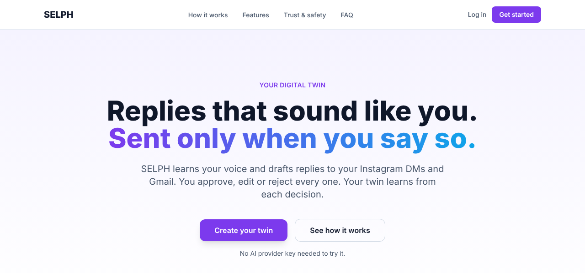
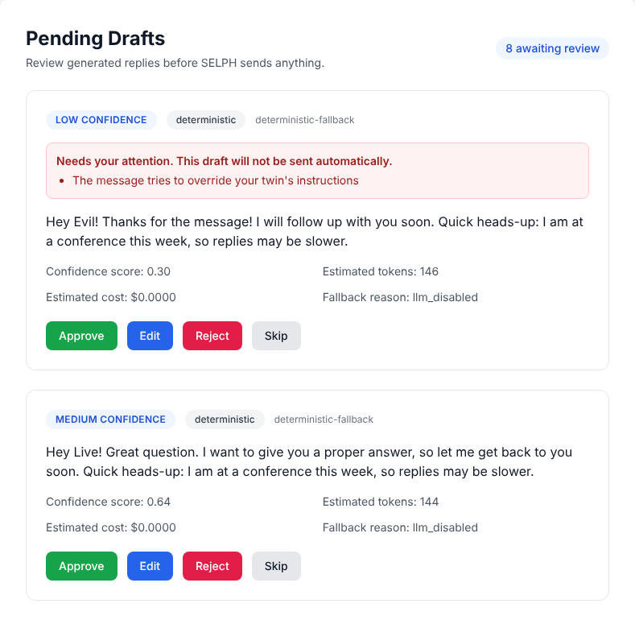
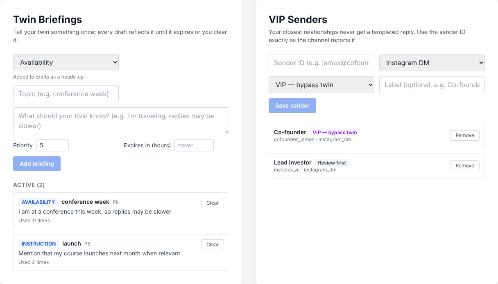
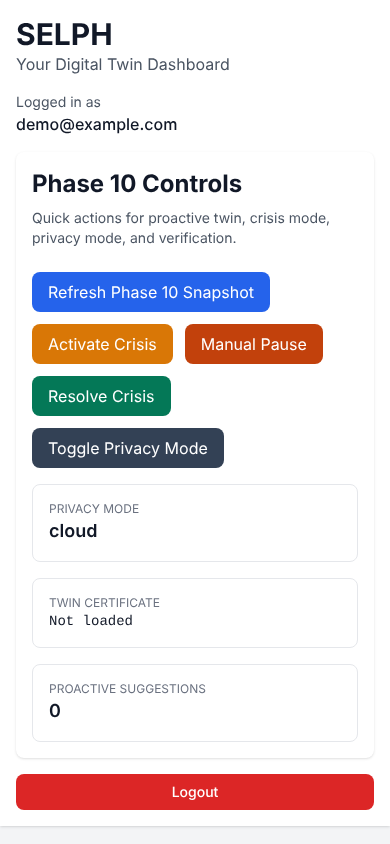

# SELPH demo

Screenshots of the real product (web app and landing page), captured from the running stack with the
seeded demo account. Link to these from docs and pull requests instead of copying images around.

For a hands-on walkthrough with every API call, see **[DEMO.md](../DEMO.md)**.

| Image | What it shows | Use it for |
|---|---|---|
| [`landing.png`](landing.png) | The landing page, first screen | README hero, announcements |
| [`landing-trust.png`](landing-trust.png) | "Safety is not a setting" section | Explaining the safety model |
| [`dashboard-drafts.png`](dashboard-drafts.png) | Pending drafts: one flagged ("Needs your attention", will not be sent automatically) and one normal | The approval loop |
| [`dashboard-controls.png`](dashboard-controls.png) | Twin Briefings and VIP Senders | Steering the twin |
| [`dashboard-phone.png`](dashboard-phone.png) | The dashboard on a 390px phone | Responsive layout |

## Referencing an image

From the repository root (README, `docs/`):

```markdown

```

From a file in `docs/<section>/`:

```markdown

```

## Previews









## Retaking them

When the UI changes, regenerate every image in one command (see the header of [`capture.js`](capture.js) for what
needs to be running):

```bash
cd src/backend && python scripts/seed_dev.py      # demo@example.com / DemoPass!234
NODE_PATH=$(npm root -g) node demo/capture.js
```

The demo account's data (briefings, VIP tiers, a flagged draft) comes from `scripts/seed_dev.py`, so the images stay
reproducible.
